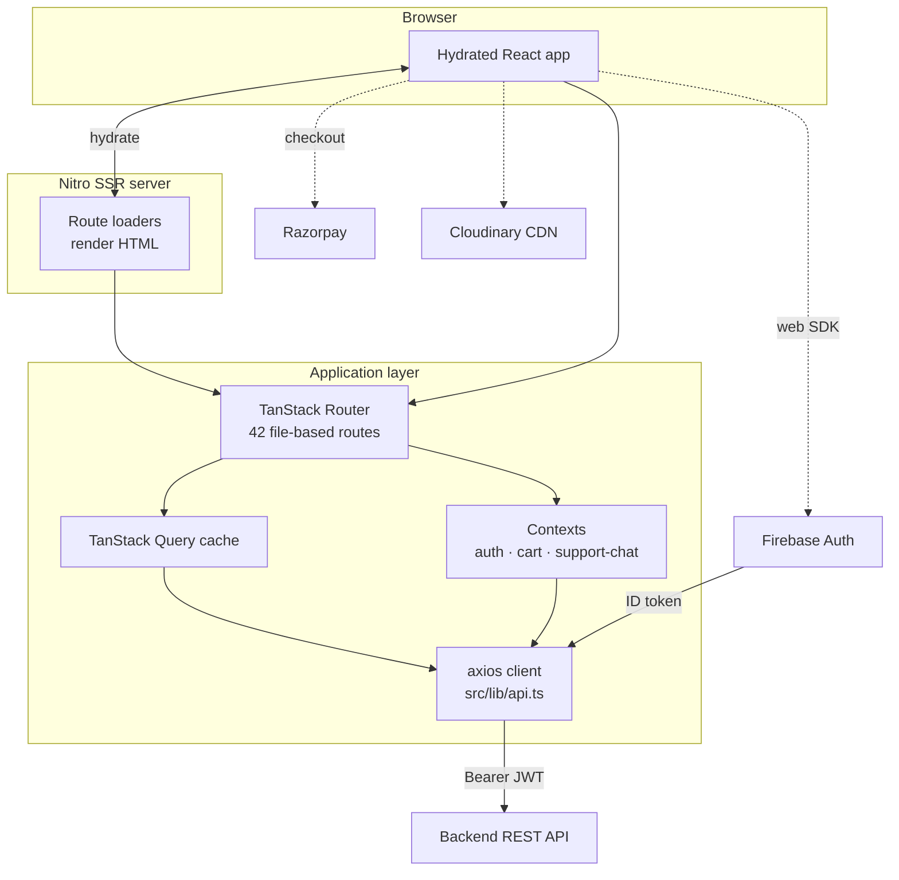
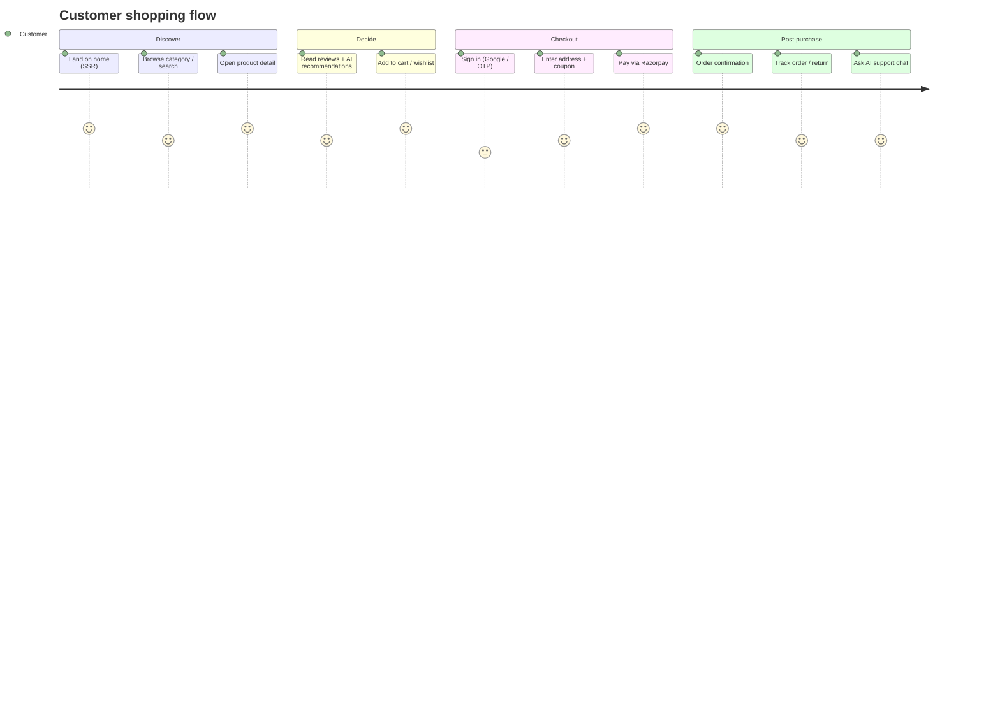
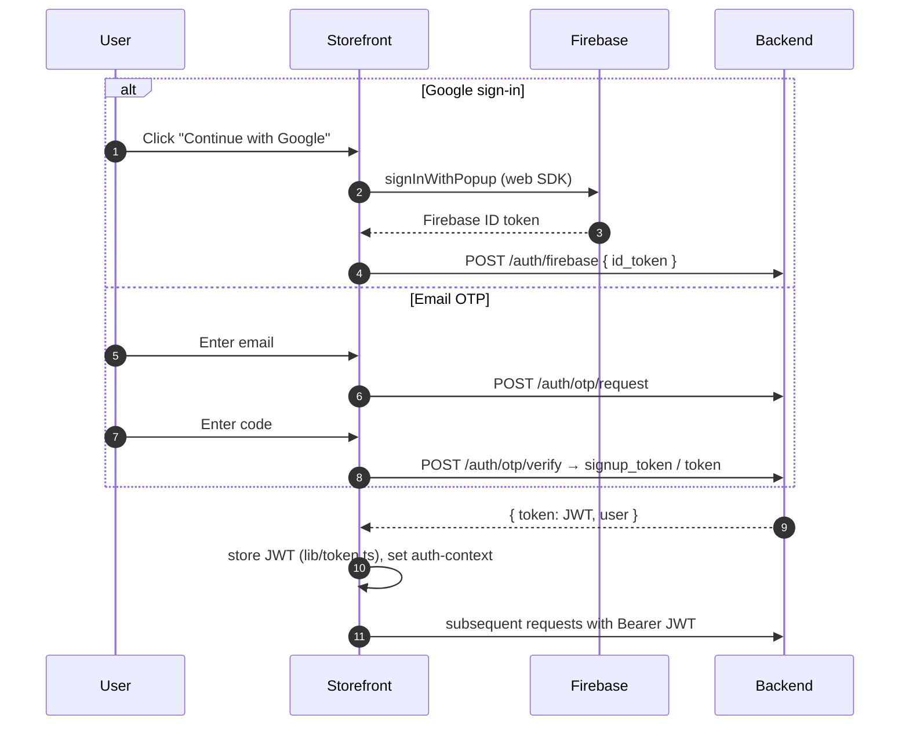

# 🐠 Jharna Aquarium — Storefront (Frontend)

> **Server-rendered customer storefront** for the Jharna Aquarium e-commerce platform.
> Built with **TanStack Start** (React 19 + Nitro SSR), **Tailwind CSS**, **shadcn/ui**,
> **TanStack Query/Router**, **Firebase Auth**, **Razorpay** checkout and an **AI support chat**.

<p align="left">
  
  
  
  
  
  
</p>

This repository is **one of three** that make up the Jharna Aquarium platform:

| Repo | Role | Stack |
|------|------|-------|
| **`Jharna-Aquarium-Frontend`** ← _this repo_ | Customer storefront (SSR) | TanStack Start · React · Tailwind |
| [`Jharna-Aquarium-Adminpanel`](https://github.com/ulmind-com/Jharna-Aquarium-Adminpanel) | Internal admin dashboard | React · Vite · React Router |
| [`Jharna-Aquarium-Backend`](https://github.com/ulmind-com/Jharna-Aquarium-Backend) | REST API + business logic | FastAPI · MongoDB · Motor |

> See [`docs/SYSTEM_ARCHITECTURE.md`](docs/SYSTEM_ARCHITECTURE.md) for how all three repositories communicate.

---

## 📑 Table of Contents

1. [Overview](#-overview)
2. [Tech Stack](#-tech-stack)
3. [Architecture](#-architecture)
4. [User Journey](#-user-journey)
5. [Authentication Flow](#-authentication-flow)
6. [Data Fetching](#-data-fetching)
7. [Project Structure](#-project-structure)
8. [Routes](#-routes)
9. [Getting Started](#-getting-started)
10. [Environment Variables](#-environment-variables)
11. [Scripts](#-scripts)
12. [Deployment](#-deployment)

---

## 🔭 Overview

A fast, SEO-friendly storefront with **server-side rendering + client hydration**. It renders the
catalog, product detail, cart, checkout, account area, blog, combos, gifting, store locator and an
AI-powered support chat. All data comes from the [backend REST API](https://github.com/ulmind-com/Jharna-Aquarium-Backend);
the frontend holds **no database and no server secrets** — only public `VITE_*` config (Firebase web
keys, Razorpay `key_id`, API base URL).

---

## 🧰 Tech Stack

| Concern | Technology |
|---------|-----------|
| Framework | **TanStack Start** (React 19 SSR via Nitro) |
| Routing | TanStack Router (file-based, `src/routes`) |
| Data | TanStack Query (caching) + **axios** client (`src/lib/api.ts`) |
| UI | Tailwind CSS v4 + **shadcn/ui** (Radix primitives) |
| State | React Context — `auth`, `cart`, `support-chat` |
| Auth | Firebase (Google) + email/OTP → backend JWT |
| Payments | Razorpay checkout (`src/lib/razorpay.ts`) |
| AI chat | `ai` + `streamdown` streaming (`src/components/ai-elements`) |
| Motion/Media | `motion`, `embla-carousel`, `@lottiefiles/dotlottie-react` |
| Forms | react-hook-form + zod |
| Charts | recharts (account/analytics widgets) |
| Tooling | Vite · Bun · ESLint · Prettier · TypeScript |
| Deploy | Nitro output → Cloudflare Workers / Netlify |

---

## 🏛 Architecture



The axios client attaches the stored JWT (`src/lib/token.ts`) to every request and reads
`VITE_API_BASE_URL`. TanStack Query dedupes and caches reads; mutations invalidate query keys defined
in `src/api/services.ts`.

---

## 🧭 User Journey



---

## 🔐 Authentication Flow



---

## 🔌 Data Fetching

- **Single axios instance** — `src/lib/api.ts`, base URL from `VITE_API_BASE_URL`, JWT interceptor.
- **Typed service layer** — `src/api/services.ts` groups endpoints (`productsApi`, `ordersApi`,
  `authApi`, `reviewsApi`, `chatApi`, …) and exports `queryKeys` for cache consistency.
- **SSR loaders** fetch critical data on the server for first paint; the client rehydrates the same
  TanStack Query cache.

---

## 🗂 Project Structure

```
jharnaaquarium Frontend/
├── src/
│   ├── routes/            # 42 file-based routes (TanStack Router)
│   │   ├── __root.tsx     # root layout / providers
│   │   ├── index.tsx      # home
│   │   ├── product.$id.tsx, products.tsx, category.$slug.tsx
│   │   ├── cart.tsx, checkout.tsx, order-confirmation.tsx
│   │   ├── account.*.tsx  # profile, orders, addresses, reviews, security…
│   │   └── blog.*, combos.*, gifting, support, …
│   ├── components/        # UI by domain
│   │   ├── ui/            # shadcn/ui primitives
│   │   ├── commerce/ product/ category/ home/ account/
│   │   ├── auth/ blog/ support/ layout/ shared/
│   │   └── ai-elements/   # streaming AI chat UI
│   ├── contexts/          # auth-context, cart-context, support-chat-context
│   ├── api/services.ts    # typed API layer + queryKeys
│   ├── lib/               # api(axios), token, firebase, razorpay, utils…
│   ├── hooks/  types/  config/   # brand config, shared types
├── public/                # static assets
├── docs/                  # engineering docs + diagrams
├── vite.config.ts         # TanStack Start + Nitro config
├── netlify.toml           # Netlify deploy config
├── components.json        # shadcn/ui config
└── .env.example
```

---

## 🧷 Routes

42 file-based routes under `src/routes`. Highlights:

| Area | Routes |
|------|--------|
| Catalog | `index`, `products`, `plants`, `category.$slug`, `product.$id`, `search`, `offers` |
| Combos | `combos.index`, `combos.$id` |
| Cart & checkout | `cart`, `checkout`, `order-confirmation` |
| Account | `account.index/profile/orders/orders.$id/addresses/coupons/reviews/security` |
| Auth | `login`, `signup`, `verify-otp` |
| Content | `blog.index`, `blog.$slug`, `about`, `contact`, `press`(via components) |
| Services | `garden-services`, `gifting`, `corporate-gifts`, `locate-store` |
| Policy | `privacy`, `terms`, `shipping`, `returns` |
| Engagement | `wishlist`, `support` |

---

## 🚀 Getting Started

### Prerequisites
- **Bun** (preferred) or Node 20+
- A running backend (local or deployed)

### Install & run

```bash
bun install
cp .env.example .env     # set VITE_API_BASE_URL + Firebase keys
bun run dev              # vite dev (SSR) on http://localhost:3000
```

Using npm instead:

```bash
npm install
npm run dev
```

> To point at a local backend, set `VITE_API_BASE_URL=http://127.0.0.1:8000` in `.env.local`.

---

## 🔑 Environment Variables

Only **public** client config lives here (all prefixed `VITE_`). **`.env` is git-ignored.**
See [`.env.example`](.env.example).

| Variable | Purpose |
|----------|---------|
| `VITE_API_BASE_URL` | Backend REST API base URL |
| `VITE_FIREBASE_API_KEY` / `_AUTH_DOMAIN` / `_PROJECT_ID` / `_APP_ID` | Firebase web config (public) |
| `VITE_GOOGLE_CLIENT_ID` | Google sign-in (optional) |
| `VITE_RAZORPAY_KEY_ID` | Razorpay public key for checkout |

---

## 📜 Scripts

| Script | Action |
|--------|--------|
| `bun run dev` | Dev server (SSR + HMR) |
| `bun run build` | Production build → `.output/` |
| `bun run preview` | Preview the production build |
| `bun run lint` | ESLint |
| `bun run format` | Prettier |

---

## 📦 Deployment

Nitro produces `.output/`, deployable to:

- **Cloudflare Workers** — `wrangler.json` is generated on build.
- **Netlify** — `netlify.toml` is included.

```bash
bun run build
npx nitro deploy --prebuilt     # or platform-native deploy
```

Set `VITE_*` variables in the hosting dashboard. Never ship `.env`.

---

<sub>Part of the **Jharna Aquarium** platform · Storefront · TanStack Start + React</sub>
