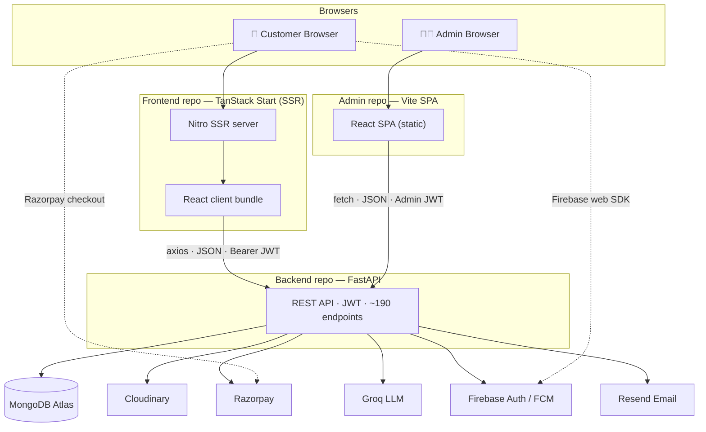
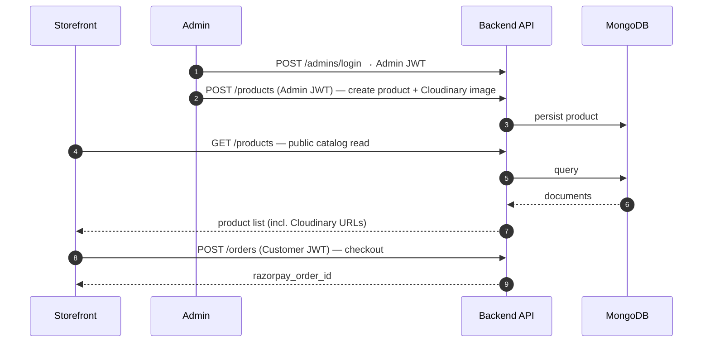
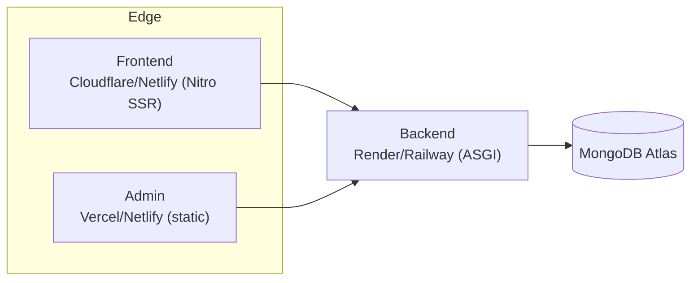

# 🌐 Jharna Aquarium — System Architecture (All Repositories)

This document explains how the **three independent repositories** that make up the Jharna
Aquarium platform fit together, communicate, and are deployed. Each repo is self-contained and
deployable on its own; together they form a decoupled **SPA/SSR storefront + admin + API** system.

| Repository | Responsibility | Stack | Talks to |
|-----------|----------------|-------|----------|
| [`Jharna-Aquarium-Frontend`](https://github.com/ulmind-com/Jharna-Aquarium-Frontend) | Customer storefront (SSR + hydration) | TanStack Start · React 19 · Tailwind · shadcn/ui · Firebase · Razorpay | → Backend REST API |
| [`Jharna-Aquarium-Adminpanel`](https://github.com/ulmind-com/Jharna-Aquarium-Adminpanel) | Internal operations dashboard | React · Vite · React Router | → Backend REST API |
| [`Jharna-Aquarium-Backend`](https://github.com/ulmind-com/Jharna-Aquarium-Backend) | REST API, business logic, persistence | FastAPI · MongoDB (Motor) · Cloudinary · Razorpay · Groq | ↔ MongoDB + 3rd-party services |

---

## 1. High-level topology

**Key point:** the two frontends never touch the database or third-party secrets directly (except
client-safe Firebase/Razorpay public keys). All privileged operations go through the backend, which
is the single source of truth and the only holder of server secrets.

---

## 2. Communication contract

- **Protocol:** HTTPS, JSON request/response bodies.
- **Client → Backend:** the storefront uses **axios** with `VITE_API_BASE_URL`; the admin panel uses
  `fetch` with `VITE_API_URL`. Both send `Authorization: Bearer <JWT>`.
- **Auth planes:**
  - Customer JWT (7-day) — issued by `/auth/*` (email OTP or Firebase ID-token exchange).
  - Admin JWT (1-year) — issued by `/admins/login`; required for all mutating catalog/CMS routes.
- **CORS:** backend `CORS_ORIGINS` must list both frontend origins.
- **Media:** uploads are proxied through the backend `/upload` router to Cloudinary; the backend
  stores the returned `secure_url` on the document. Browsers load images straight from Cloudinary's CDN.
- **Payments:** backend creates the Razorpay order; the browser completes checkout with the public
  `key_id`; the backend verifies the signature and the webhook.

> The admin **writes** catalog/content; the storefront **reads** it and **writes** customer-scoped
> data (orders, reviews, wishlist). They are fully decoupled and only share the backend contract.

---

## 3. Data & secrets ownership

| Concern | Owned by | Notes |
|---------|----------|-------|
| Product/category/content data | Backend → MongoDB | `nursery_ecommerce` database |
| Media assets | Cloudinary | URLs stored on documents |
| Server secrets (DB, Cloudinary, Razorpay, Groq, Resend) | **Backend only** | never shipped to clients |
| Client-safe keys (Firebase web config, Razorpay `key_id`) | Frontend `.env` (`VITE_*`) | public by design |
| Sessions | Stateless JWT | no server session store |

---

## 4. Deployment shape

- **Frontend** → SSR build (`.output/`) deployed to Cloudflare Workers / Netlify (config present).
- **Admin** → static `dist/` deployed to Vercel / Netlify.
- **Backend** → container (`Dockerfile`) or ASGI process on Render / Railway / Fly.
- Each repo ships its own CI (`.github/workflows/ci.yml`): install + build / boot-check on push & PR.

---

## 5. Repository independence

Each repository:
- has its own git history, `README.md`, `docs/`, environment template, and CI pipeline;
- can be cloned, built, and run **without the other two present** (pointing `VITE_API_*` at any
  running backend instance);
- exposes or consumes only the **HTTP contract** above — there are no shared code packages or build
  steps across repos.

This keeps the three teams (storefront, operations tooling, platform) able to ship independently.
